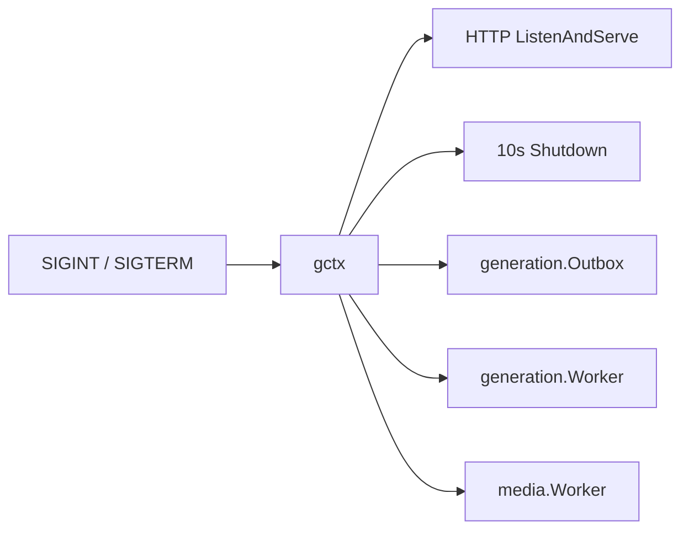

# 架构与进程模型

## 解决什么问题

一个进程要同时接 HTTP、投递发件箱、跑远端生成 worker 和媒体 worker。任一循环退出或收到 SIGTERM，其余部分要一起停，不能留下还占着租约的后台任务。

## 怎么实现

入口是 `cmd/server/main.go`。`run` 先加载配置，创建 slog，打开 MySQL 和 Redis，再组装领域服务。HTTP 用 chi，SQL 由 sqlc 生成到 `internal/sqlcdb`，迁移在 `db/migrations`。

进程用 `errgroup` 把五件事绑在同一个 `signal.NotifyContext` 上：

```125:148:cmd/server/main.go
	server := &http.Server{Addr: cfg.HTTPAddr, Handler: handler}
	g, gctx := errgroup.WithContext(ctx)

	g.Go(func() error {
		logger.Info("服务已启动", "addr", cfg.HTTPAddr, "env", cfg.AppEnv, "log_format", cfg.LogFormat)
		err := server.ListenAndServe()
		if err != nil && !errors.Is(err, http.ErrServerClosed) {
			return err
		}
		return nil
	})
	g.Go(func() error {
		<-gctx.Done()
		shutdownCtx, cancel := context.WithTimeout(context.Background(), 10*time.Second)
		defer cancel()
		return server.Shutdown(shutdownCtx)
	})
	g.Go(func() error {
		err := outbox.Run(gctx)
		if errors.Is(err, context.Canceled) {
			return nil
		}
		return err
	})
```

后面还有 `generation.Worker.Run` 和 `media.Worker.Run`。`gctx` 取消后，监听循环把 `http.ErrServerClosed` 当成正常退出，两个 worker 把 `context.Canceled` 当成正常退出。真正的错误会让 `g.Wait` 返回非 nil，进程以状态码 1 结束。



路由集中在 `internal/httpapi/router.go`。handler 只解析请求、取会话、调用领域服务、写 `{code,msg,data}`。业务规则不写在路由函数里。

## 和 Java 的对应与差异

Java 是 Spring Boot 单进程：Web 容器、`@Scheduled` 发件箱和生成调度器跑在同一个 JVM。Go 侧没有第二套 Web 框架，也没有 goroutine 泄漏式的 `go func` 裸启动；后台循环都挂在 errgroup 上，取消信号只有一份。

Java 的包按 controller / service / repository 分层。Go 按领域放在 `internal/auth`、`internal/resource`、`internal/generation`、`internal/media`。sqlc 生成代码和手写 SQL 分开，不在 service 里拼 SQL。

## 常见坑

- 在 handler 里再开一个不听 `gctx` 的 goroutine，停机时它还会继续写库。
- 把 `ListenAndServe` 的 `http.ErrServerClosed` 当成失败，优雅停机会被记成进程错误。
- 数据库事务包住 ffmpeg 或供应商 HTTP。现有 worker 先提交租约，再在事务外跑外部进程。
