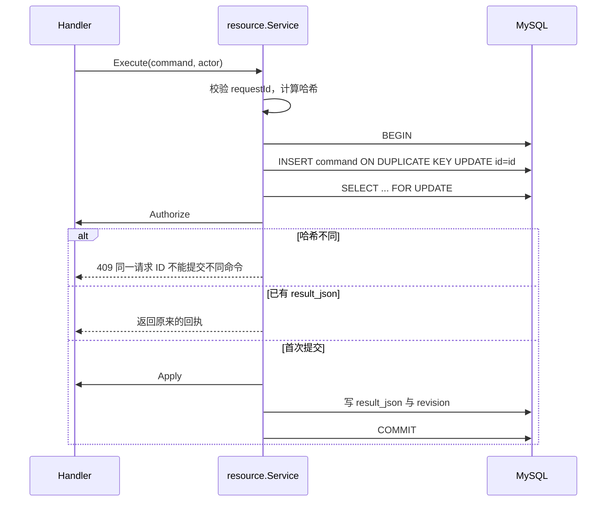

# 资源命令管道

## 解决什么问题

剧本、分镜、资产会被页面连点、刷新重放，也会被两个标签同时改。需要三件事同时成立：

1. 同一个用户的同一个 `requestId` 只产生一次业务结果。
2. 同一个 `requestId` 如果正文变了，必须拒绝，不能静默执行新内容。
3. 更新和删除要带着客户端看见的版本，版本不符就冲突，并留下改前改后的 revision。

## 怎么实现

`internal/resource/service.go` 的 `Execute` 是唯一写入口。顺序固定：



幂等键是表 `afv_resource_command` 的 `uk_resource_command_request (actor_user_id, request_id)`。插入用 `ON DUPLICATE KEY UPDATE id = id`，所以并发的第二次插入不会报错，接着 `FOR UPDATE` 锁住已有行。哈希来自 `internal/resource/hash.go`：`operation + command + actor + origin` 的 SHA-256。

```9:26:internal/resource/hash.go
func HashCommand(cmd Command, actorUserID int64, origin Origin) (string, error) {
	payload := map[string]any{
		"operation": cmd.Operation(),
		"command":   cmd,
		"context": map[string]any{
			"actorUserId": actorUserID,
			"origin":      origin,
		},
	}
```

乐观锁写在各资源的 `UPDATE ... WHERE id = ? AND version = ?`。影响行数不是 1 就返回冲突。提交成功后 `commit` 把回执写入 `result_json`，并把每个 `Change` 插入 `afv_resource_revision`（改前 JSON、改后 JSON、变更字段、提交后的版本）。

处理器按 `(resourceType, operation)` 注册在 `internal/resource/handler.go`。`cmd/server/main.go` 把项目、剧本、分镜、资产、图片任务、视频任务的处理器放进同一个 `Registry`。重复注册会在启动时失败。

阶段5新增的类型使用 Java `CanvasValueType` 的 code：`storyboard`、`storyboardEpisode`、`storyboardScene`、`shot`、`asset`、`assetItem`。图片和视频任务不在 Java 的画布类型里，Go 使用 `imageTask`、`videoTask`，只出现在本服务的 revision 里。已经上线的剧本类型仍是 `script_episode` / `script_scene`，没有改名，避免旧命令哈希和历史 revision 对不上。

分镜、资产有 Java 的 `version` 列，`PATCH` / `DELETE` 直接比较这一列。图片和视频任务表没有这个列。处理器锁住任务行之后，读取：

```sql
SELECT CAST(COALESCE(MAX(resource_version), 0) AS SIGNED)
FROM afv_resource_revision
WHERE resource_type = ? AND resource_id = ?
```

创建时 revision 版本是 0。下一次更新必须带 0，成功后 revision 记 1。因为任务行已经 `FOR UPDATE`，两个事务不会同时读到同一个最大版本。

子资产的更新和删除额外要求父资产版本（请求里的 `assetVersion` 或查询参数 `parentVersion`）。这个指针带 `json:"parentVersion,omitempty"`。不传时它不进入哈希，所以旧的剧本删除命令重放仍然匹配。

## 和 Java 的对应与差异

Java `ResourceCommandService` 同样是 admit、锁命令、比对哈希、授权、应用、写 revision。分镜和资产的允许字段跟 `StoryboardFields`、`AssetFields` 对齐：例如分镜补丁不能改 `title` 和 `sortOrder`，排序只在创建时给出；镜头时长 0 到 86400 秒、最多两位小数；资产类型限定在 character/scene/prop 等九种。

Java 的图片、视频任务不走这条命令管道，删除也不带版本。Go 为了和剧本、分镜共用幂等与 revision，删除 `DELETE /api/generation/image/{id}?version=&requestId=` 必须带这两项。返回值仍是 `true`，和 Java 的 `CommonResult<Boolean>` 一样。

Go 还没有 resource event、画布投递和团队 ACL。授权只锁“个人拥有的项目”。

## 常见坑

- 重试时改了正文却沿用 `requestId`，会得到 409，而不是新的结果。这是故意的。
- 客户端拿着旧 `version` 保存，会 409。应重新 GET 再提交。
- 给 `DeleteCommand` 增加必填字段且不使用 `omitempty`，会改变所有历史命令的哈希，正在飞的重试会全部冲突。
- 图片任务的 `version` 不在任务行上。直接 `UPDATE afv_image_task` 不会推进版本，下一次命令仍可能按旧 revision 通过。业务写入应走 `resource.Service`。
