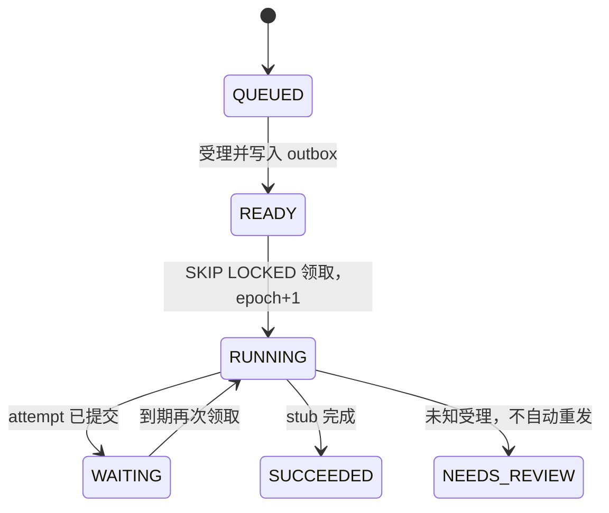

# MySQL 租约作业队列

## 解决什么问题

生成和媒体处理比一次 HTTP 请求长。多个进程会同时抢任务。进程崩溃后，任务不能永远停在“执行中”，也不能被两个进程各提交一次付费请求。

## 怎么实现

队列表是 `afv_remote_generation_job` 和 `afv_media_job`（迁移 `00004`、`00005`）。worker 在 `internal/generation/worker.go`，领取 SQL 在 `db/queries/generation.sql`。

候选行用数据库时钟判断是否到期，并跳过别的事务已经锁住的行：

```87:114:db/queries/generation.sql
SELECT id, model_id, actor_user_id, project_id, phase, permit_held, cancel_requested
FROM afv_remote_generation_job
WHERE (
    (state IN ('READY', 'WAITING') AND next_poll_at <= UTC_TIMESTAMP(6))
    OR (state = 'RUNNING' AND lease_until <= UTC_TIMESTAMP(6))
    OR state = 'NEEDS_REVIEW'
    OR (state = 'UNKNOWN_SUBMISSION' AND (permit_held = TRUE OR phase <> 'FINISHED'))
  )
ORDER BY next_poll_at, id
LIMIT 128
FOR UPDATE SKIP LOCKED;
```

领到之后同一事务里把状态改成 `RUNNING`，`owner_epoch` 加 1，租约设为现在起 90 秒，并记下 `owner_instance_id`。epoch 是围栏：旧进程如果还拿着过期的 epoch，心跳和完成更新的 `WHERE owner_epoch = ?` 会影响 0 行，写不回去。

心跳 `HeartbeatRemoteGenerationJob` 还要求 `lease_until > UTC_TIMESTAMP(6)`。租约已经过期的 worker 不能靠心跳把租约续上。

额度是短事务里的计数，不是模型表。`CountPermitHeldByActor` 统计 `permit_held = TRUE`。超过容量时 `DeferJobForCapacity` 把 `next_poll_at` 推后 2 秒，不把任务标失败。Java 按 `ai_model` 做 `hasCapacity`；这里还没有模型表，所以额度是用户维度的占位。

状态机留在作业行上：`QUEUED` 受理之后进入 `READY`，worker 领走变成 `RUNNING`，向供应商提交前先把 attempt 的 `submitted_at` 写上。进程崩溃后，带有 `provider_task_id` 的 attempt 不会再发一次付费请求，而是进入核实。当前供应商是 stub：prepare、WAITING、SUCCEEDED。没有真实 HTTP。

媒体作业是同一套租约，外加 `internal/media/worker.go` 的单槽。`FFMPEG_VERSION` 只跑 `ffmpeg -version`，把输出放进 checkpoint，用来验证取消和杀进程。



## 和 Java 的对应与差异

Java `V1.1.3.0.3` 的 generation / media job 使用同样的 `FOR UPDATE SKIP LOCKED`、`owner_epoch` 和租约。Go 把这一子集做成了可运行的 worker，kind 仍是 `ECHO`，不会创建 `afv_image_task` 行。阶段5的任务表是业务数据，还没有接进这条队列。

## 常见坑

- 用 `SELECT ... FOR UPDATE` 而不加 `SKIP LOCKED`，空闲 worker 会堵在别的进程正在处理的行上。
- 心跳只比较 `owner_instance_id`，不比较 epoch。进程重启后实例 ID 可能复用，旧循环会把新租约续掉。现有 SQL 两个都比。
- 在“也许已经提交给供应商”之后自动再插一条 attempt。正确的出口是核实，而不是再付一次费。
