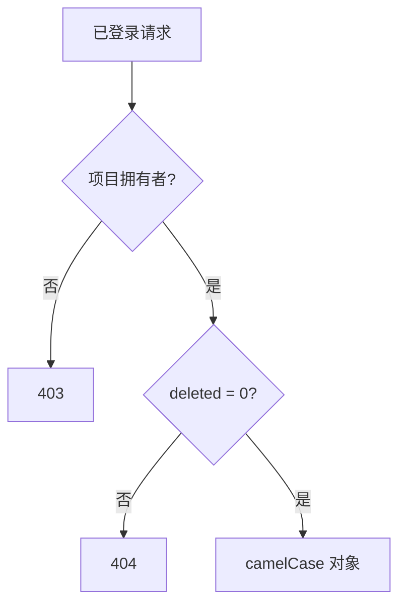

# 分镜、资产与图片/视频任务

## 解决什么问题

前端在剧本之后要读写分镜树、项目资产，以及图片/视频任务记录。这些表必须和 Java Flyway 的最终形状一致，这样两种进程可以看同一张表。本阶段只做数据和权限，不调用模型。

## 表

迁移 `db/migrations/00006_storyboard_asset_tasks.sql` 按 Java 基线 `B1.1.0.0.8` 建表，并补上基线之后落在这些表上的列：

| 表 | 相对基线多出来的列 | 来源 |
|---|---|---|
| `afv_storyboard`、`afv_storyboard_scene`、`afv_storyboard_item`、`afv_asset`、`afv_asset_item` | `version` | `V1.1.3.0.1` |
| `afv_storyboard_episode` | `bgm_*`，然后 `version`、`compose_job_id` | `V1.1.2.0.0`、`V1.1.3.0.1`。合成视频列和 `script_episode_id`、`deleted_id` 已在基线里 |
| `afv_image_task`、`afv_video_task` | `workflow_version_id` 及对应索引 | `V1.1.1.0.0` |
| `afv_image_item`、`afv_video_item` | 无新增列 | `platform_task_id` 在基线里已是 `varchar(512)` |

索引名和 Java 相同，包括分镜集的 `uk_sb_episode_script_episode (storyboard_id, script_episode_id, deleted_id)`。逻辑删除分镜集时把 `deleted_id` 写成行 id，否则唯一键会挡住同一剧本分集再次关联。

`image_item` / `video_item` 虽然用户点名的是任务表，但任务的读取接口要返回条目，删任务时也要把条目一起逻辑删除，所以表一起建了。没有单独的条目增改命令。

## 写接口

全部经 `resource.Service`。路由在 `internal/httpapi/router.go`，字段规则在 `internal/resource/handlers/catalog_fields.go`。

| 方法与路径 | 资源 | 说明 |
|---|---|---|
| `POST /api/storyboard` | storyboard | body：`requestId`、`projectId`、`fields` |
| `PUT /api/storyboard` | storyboard | `id`、`version`、`requestId`、`patch`。没有删除分镜文档的接口 |
| `POST/PUT/DELETE /api/storyboard/episode` | storyboardEpisode | 创建要 `episodeNumber` 和父版本。删除会级联软删镜头和场次 |
| `PUT /api/storyboard/episode/{id}/bindScriptEpisode` | storyboardEpisode | patch 只能有 `scriptEpisodeId` |
| `POST/PUT/DELETE /api/storyboard/scene` | storyboardScene | 父对象是分镜集。删除会先软删镜头 |
| `POST/PUT/DELETE /api/storyboard/item` | shot | 父对象是场次。Java 类型名是 shot |
| `PUT /api/storyboard/item/{id}/updateFrame` | shot | `frameType` 为 first 或 last，转成首帧/尾帧字段 |
| `POST/PUT/DELETE /api/asset` 与 `/api/asset/item` | asset、assetItem | 子资产要父版本。删除主资产会先软删全部子资产；删除子资产时若图片是封面则清空封面 |
| `POST/PUT /api/generation/image` 与 video | imageTask、videoTask | 创建和修改走命令管道，创建只落排队中的任务行 |
| `DELETE /api/generation/image/{id}` 与 video | 同上 | 不带 `version` / `requestId`。状态须为 2、3、4、6，否则 409；先软删条目再软删任务 |

创建子对象的 body 与剧本分集相同：`parentId`、`parentVersion`、`requestId`、`fields`。父 id 由路由放进 fields，调用方不能在 fields 里再写一遍。

删除分镜集时，同一事务里先软删镜头，再软删场次，最后软删分集并写 `deleted_id`。删除场次时先软删镜头。删除主资产时先软删全部子资产。每一个被软删的子行都写一条 revision。删子资产时，若图片地址与主资产封面相同，封面被清空，主资产版本加一。剧本删除分集时同样为每个场次写 revision。

没有 `DELETE /api/storyboard/{id}`。Java 不删除分镜文档本身。清空并保留父行的接口是 `POST /api/storyboard/{id}/clearContent` 和 `POST /api/storyboard/episode/{id}/clearContent`。

## 读接口

`internal/resource/content_query.go` 先确认项目属于当前用户（`owner_type = 1` 且 `owner_id` 匹配），再查 `deleted = 0`。分镜集和场次的 `deleted` 在 Java 里可空，查询用 `IFNULL(deleted, 0) = 0`。

| 方法与路径 | 返回 |
|---|---|
| `GET /api/storyboard/project/{projectId}` | 该项目最新一条未删除分镜 |
| `GET /api/storyboard/{id}` 以及 episode、scene、item | 单个对象 |
| `GET /api/storyboard/{storyboardId}/episodes`、`/scenes`、`/items` | 数组 |
| `GET /api/storyboard/episode/{episodeId}/scenes` | 数组 |
| `GET /api/storyboard/scene/{sceneId}/items` | 数组 |
| `GET /api/asset/{id}`、`/api/asset/item/{id}`、`/api/asset/{assetId}/items` | 对象或数组 |
| `GET /api/asset/list?projectId&type&keyword` | 数组。关键字按包含匹配，`%` 和 `_` 会转义 |
| `GET /api/asset/list-with-items` | 资产数组，每项带 `items` |
| `GET /api/generation/image/{taskId}` | 按公开 `taskId` 查，不是数字主键 |
| `GET /api/generation/image/{id}/items` | 数字主键下的条目，没有条目时是空数组 |
| `GET /api/generation/image/page?pageNo&pageSize` | `{list,total}`，只含当前用户的任务 |
| video 与 image 对称 | 同上 |

JSON 字段是 camelCase，时间格式 `2006-01-02T15:04:05`，与现有剧本接口一致。任务响应多一个 `version`，来自 revision，不是表列。

图片任务若 `user_id` 就是当前用户，即使项目校验在分页里被收窄，单条读取仍允许；别人的任务只有在他拥有 `project_id` 时才能读。分页只按 `user_id`，和 Java `pageByUser` 一致。

## 和 Java 的对应与差异

字段名、类型、索引按 Java 最终 DDL。允许修改的分镜和资产字段按 `StoryboardFields`、`AssetFields`。`updateFrame` 和 `bindScriptEpisode` 只是把 Java 控制器的窄补丁翻译成普通 PATCH。

明确不做、避免和 Java 路径撞车的接口：

- `POST /api/generation/image/submit` 与 video submit。那两个会写受理记录并调用供应商。本阶段的 `POST /api/generation/image` 只插入 `status = 0` 的任务行，返回完整对象而不是单独的 taskId 字符串。
- `compose-video`、`/children`、`/batch`、`/statistics`。`clearContent` 已实现，只清空子层。
- `GET /api/asset/metadata/{assetType}`、`/all`、`/batch`。元数据是代码里的字段字典；`/all` 的分页协议和 `/list` 不同。

图片和视频任务的删除与 Java 一样不走资源命令，因此不要求 `version` 或 `requestId`。前端 `deleteImage` / `deleteVideo` 只传数字 id。状态不是 2、3、4、6 时返回 409，文案分别是「请等待图片生成结束后再删除记录」和「请等待视频生成结束后再删除记录」。

## 常见坑

- 用数字主键调用 `GET /api/generation/image/{taskId}`。这条路径匹配的是公开 `taskId` 字符串。条目路径才是数字 id。
- 调用 `DELETE /api/storyboard/{id}`。这个路由不存在；清空整棵分镜走 `POST /api/storyboard/{id}/clearContent`。
- 在任务仍是排队或处理中时删除它。会得到 409，而不是把条目一起删掉。
- 在补丁里传 `sortOrder`。分镜树的排序只在创建时接受；子资产允许改 `sortOrder`。
- 新建任务时自己传 `status: 2`。创建会拒绝，状态固定为排队中。补丁可以改 0 到 3，但这只改数据，不会启动 worker。
- 指望 `modelId` 不存在时返回 404。模型表还没建，id 只是存下来。
