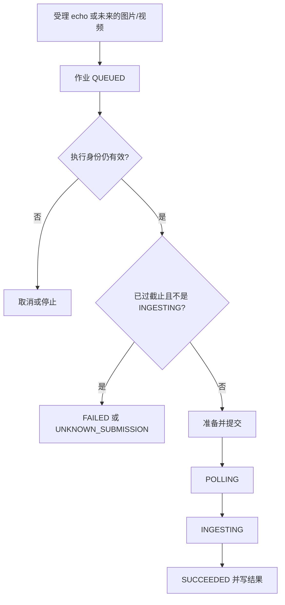

# 图片与视频任务

## 任务记录

图片任务和视频任务是业务表上的一行，加上若干结果条目。它们描述「用户要生成什么」，还不是供应商受理。

创建时状态固定为 0（排队）。调用方不能在创建请求里把状态写成完成。视频任务必须有提示词或首帧。数量是 1 到 16。时长是 0 到 86400 秒，最多两位小数。

这两张表没有 `version` 列，Java 也没有。修改时的乐观锁用 `afv_resource_revision` 里该资源的最大 `resource_version`。

## 状态

| 值 | 含义 | 能否删除记录 |
|---|---|---|
| 0 | 排队 | 否 |
| 1 | 处理中 | 否 |
| 2 | 完成 | 能 |
| 3 | 失败 | 能 |
| 4、6 | Java 允许删除，枚举说明里没有单独名字 | 能 |
| 其他 | 未结束 | 否 |

不允许删除时返回 409。文案分别是「请等待图片生成结束后再删除记录」和「请等待视频生成结束后再删除记录」。删除只软删条目和任务，不写资源命令，也不要 `version` 或 `requestId`。前端 `deleteImage` / `deleteVideo` 只传 id。

## 从受理到完成

已经实现的是 echo 受理、租约、截止时间、身份检查和 stub 完成。echo 不写 `afv_image_task` / `afv_video_task`。

## 尚未实现

| 环节 | 状态 |
|---|---|
| `POST /api/generation/image/submit` 与 video submit | 未做。提交会创建受理并把任务行交给队列 |
| 真实图片、视频供应商 | 未做 |
| 按 `ai_model` 计算每人并发 | 未做。现在是固定 8 |
| 结果写入 `image_item` / `video_item` 并维护 `success_count` | 未做。条目表存在，没有生成 worker 去插 |
| 合成、画布节点、ComfyUI、MCP、LLM/Agent | 未做 |

不做的原因是这些步骤要么调用外部供应商，要么依赖还没有的模型、画布和智能体表。任务表的增删改查不代替提交。
