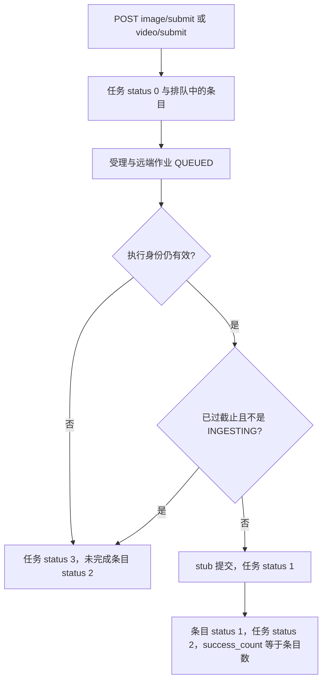

# 图片与视频任务

## 任务记录

图片任务和视频任务是业务表上的一行，加上若干结果条目。它们描述「用户要生成什么」，还不是供应商受理。

创建时状态固定为 0（排队）。调用方不能在创建请求里把状态写成完成。视频任务必须有提示词或首帧。数量是 1 到 16。时长是 0 到 86400 秒，最多两位小数。

这两张表没有 `version` 列，Java 也没有。修改时的乐观锁用 `afv_resource_revision` 里该资源的最大 `resource_version`。

## 状态

| 值 | 含义 | 能否删除记录 |
|---|---|---|
| 0 | 排队 | 否 |
| 1 | 处理中 | 否 |
| 2 | 完成 | 能 |
| 3 | 失败 | 能 |
| 4、6 | Java 允许删除，枚举说明里没有单独名字 | 能 |
| 其他 | 未结束 | 否 |

不允许删除时返回 409。文案分别是「请等待图片生成结束后再删除记录」和「请等待视频生成结束后再删除记录」。删除只软删条目和任务，不写资源命令，也不要 `version` 或 `requestId`。前端 `deleteImage` / `deleteVideo` 只传 id。

## 从受理到完成

`POST /api/generation/image/submit` 和 `POST /api/generation/video/submit` 已经接通。成功时 `data` 是公开任务标识字符串，与 Java `CommonResult<String>` 一致。同一用户、同一 `requestId`、同一内容再次提交返回原来的公开标识；内容不同返回 409「此请求标识已用于不同的生成内容」。

提交时按 `count` 插入状态为 0 的条目。一次提交只建一个远端作业，输入里的 `_resultItemIds` 记下这些条目。stub 成功后把 `image_url` / `video_url` 写成 `stub://` 地址，任务状态改为 2，`success_count` 写成条目数。`stub://` 不是对象存储里的文件。

`scope.userId` 必须是当前用户。当前会话没有团队，`scope.teamId` 只要出现就返回 409「当前账号或团队已变化，请回到原提交范围确认任务」。带 `workflowVersionId` 直接拒绝，因为没有 ComfyUI 工作流表，不能把这类请求标成成功。

echo 受理仍然不写这两张业务表。资源命令上的 `POST /api/generation/image` 也仍然只建任务行，不进队列。

## 尚未实现

| 环节 | 状态 |
|---|---|
| 真实图片、视频供应商 | 未做。完成写回使用 stub 地址 |
| 按 `ai_model` 计算每人并发 | 未做。现在是固定 8。`modelId` 只保存，不查模型表 |
| 取消 `POST /{taskId}/cancel` 与 `GET /{taskId}/execution` | 未做 |
| 合成、画布节点、ComfyUI、MCP、LLM/Agent | 未做 |

数量沿用创建接口的 1 到 16。Java 提交校验是 1 到 32。提示词上限沿用本库 `TEXT` 的 65535。Java 是 100000。模型配置里的水印、配音默认值没有填，请求没写就保持空。
