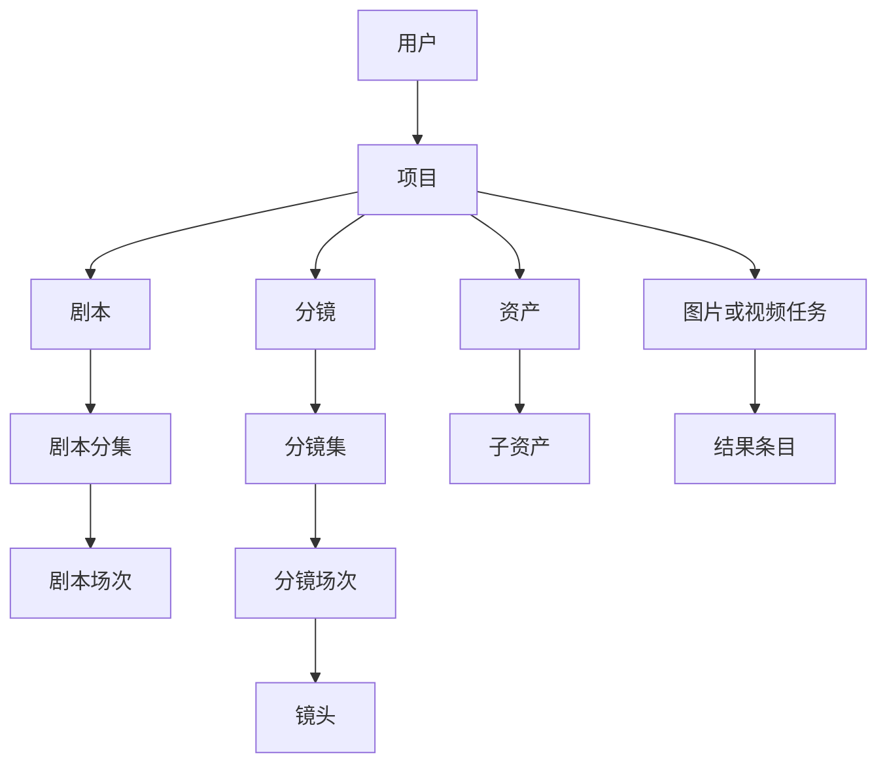

# 业务逻辑讲解

每条规则说明四件事：规则是什么、为什么这样、Go 里哪里实现、Java 对应哪里。标成「尚未实现」的环节没有半成品接口。

| 文档 | 内容 |
|---|---|
| [01 用户、团队与权限](01-user-team-permission.md) | 注册、会话、项目可见性 |
| [02 项目、剧本、分集与场次](02-project-script.md) | 工作区四层里的前两层，以及原文替换 |
| [03 分镜四层](03-storyboard.md) | 分镜、分镜集、场次、镜头 |
| [04 资产](04-assets.md) | 主资产与子资产 |
| [05 图片与视频任务](05-generation-lifecycle.md) | 任务状态，以及从受理到完成的整条链路 |
| [06 删除与版本](06-delete-and-version.md) | 谁可以删、级联顺序、乐观锁 |

