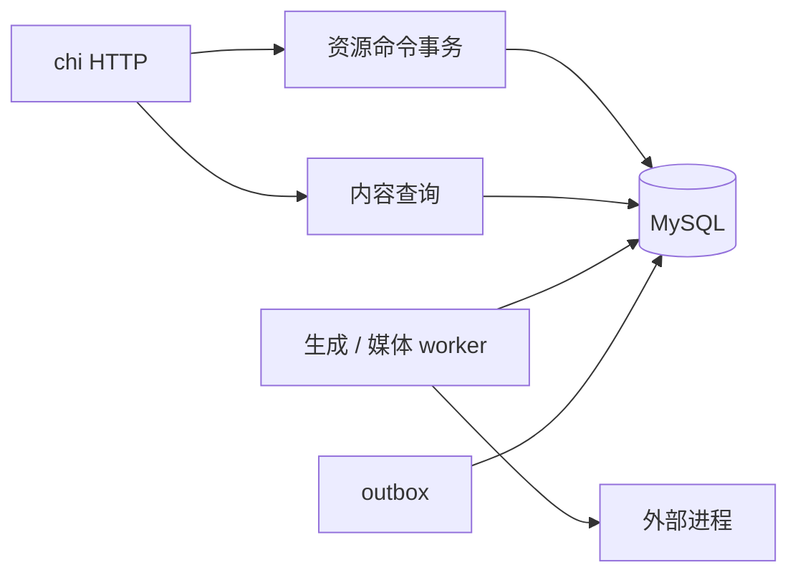

# 技术讲解

这里描述当前 Go 后端已经落地的技术机制。业务规则见 [业务逻辑讲解](../business/README.md)。阶段目录里的 `guide/` 只保留当时的对照，后续以本目录为准。

| 文档 | 内容 |
|---|---|
| [01 进程与 HTTP](01-process-and-http.md) | chi、超时、请求体上限、成功响应 |
| [02 会话](02-session.md) | Redis token，以及还没做的注册门禁 |
| [03 资源命令](03-resource-command.md) | 幂等、修订、字段顺序、清空与原文替换 |
| [04 作业队列](04-lease-queue.md) | 租约、截止时间、执行身份、额度 |
| [05 时间](05-time.md) | 作业 UTC 与内容表会话时间 |
| [06 外部进程](06-process-runner.md) | 输出上限与杀进程后的等待 |

